  
  
  

## Hi, I'm Ashutosh

**I turn product conversations into signed, live clients.** I started as a Business Analyst on a B2B travel-tech SaaS, taking clients from first demo through requirements, UAT and go-live. Today I build international pipelines for geospatial AI as a Business Development Intern at **FarmwiseAI**. Technical enough to scope it, commercial enough to sell it.

<table>
  <tr>
    <td align="center" width="25%"><h3>10 days</h3>trainee to Team Lead recognition</td>
    <td align="center" width="25%"><h3>2</h3>live P1 clients in my first month</td>
    <td align="center" width="25%"><h3>1,346</h3>outreach messages in 8 weeks</td>
    <td align="center" width="25%"><h3>34</h3>meetings across 7 markets</td>
  </tr>
</table>

## Experience

**Business Development Intern · FarmwiseAI** (Geospatial AI · AgriTech) · Chennai · *Sep 2026 – Present*
- Building the international pipeline across the Middle East, Africa, US, Australia, LATAM, APAC and Turkey.
- First 8 weeks: 1,452 organisations and 3,928 contacts researched, 1,346 outreach messages, 938 follow-ups, 34 meetings and 17 presentations.
- Presented the SkyLabOne drone-analytics demo, scripted and launched a product video, and supported MSA, NDA and MoU progress.

**Business Analyst · Shreyas Tech Solutions (TeSePr)** (B2B travel-tech SaaS) · Chennai · *Jul 2025 – Jun 2026*
- Owned the client lifecycle end to end: demo, BRD, implementation, UAT, go-live and support.
- Earned Team Lead recognition within 10 days and handled 2 live P1 clients in my first month.
- Helped cut product delivery from several months to 1–2-month cycles with AI-assisted workflows.
- Represented the company at SATTE 2026, New Delhi: demos, lead generation and competitor research.

## What I bring

| Business analysis | Business development | Pre-sales & reporting |
|---|---|---|
| Requirement gathering · BRDs | Prospecting · lead generation | Product demos · solution presentations |
| Stakeholder management | LinkedIn & email outreach | Market & competitor research |
| UAT · SaaS implementation | Discovery calls · follow-ups | Sales & client performance reports |
| Go-live & client support | Partner agreements (MSA · NDA · MoU) | Excel · dashboards · presentations |

**Technical edge:** HTML · CSS · JavaScript · AI-assisted prototyping · GIS / geospatial exposure

## Featured work

| Project | What it shows |
|---|---|
| [**My-Portfolio**](https://github.com/AshutoshKumar2312004/My-Portfolio) · [live](https://ashutoshkumar2312004.github.io/My-Portfolio/) | Reel-style 3D portfolio: scroll-driven story, Three.js journey, light and dark themes, deployed with GitHub Actions |
| [**E-Commerce**](https://github.com/AshutoshKumar2312004/E-Commerce) | Product thinking: a hand-coded storefront and an AI-assisted rebuild, side by side |
| [**GUESS-THE-NUMBER**](https://github.com/AshutoshKumar2312004/GUESS-THE-NUMBER) | Iteration: a 30-line original grown into a polished ES6 game with hints and high scores |
| [**E-learning**](https://github.com/AshutoshKumar2312004/E-learning) | Where it started: my first website, built while studying engineering |

## Education

**B.E. Electronics & Communication Engineering** · PERI Institute of Technology (Anna University) · 2021 – 2025 · CGPA 7.53

## Let's talk

Hiring for a **Business Analyst, Business Development or Pre-Sales** role? I'd love to hear about it.
[ashutoshkumar04022004.ak@gmail.com](mailto:ashutoshkumar04022004.ak@gmail.com) · [LinkedIn](https://www.linkedin.com/in/ashutosh-kumar-053428307/) · [Portfolio](https://ashutoshkumar2312004.github.io/My-Portfolio/)
